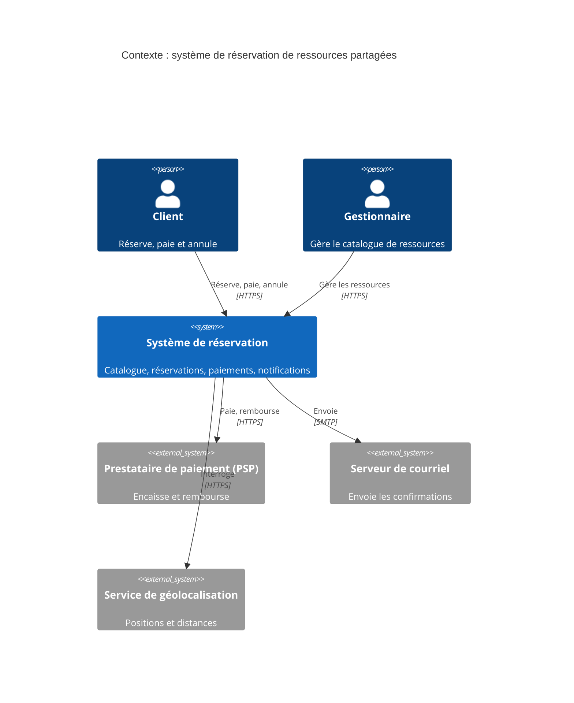

# ADR-001 : Attributs qualité prioritaires mesurables

- **Statut** : Proposé
- **Date** :
- **Variante** :
- **Séance** : S1

## Contexte

Les trois attributs qualité prioritaires de la variante, rendus mesurables par un scénario chacun. Pour chacun, indiquez la caractéristique ISO 25010 à laquelle il se rattache.

### Attribut 1 :

Caractéristique ISO 25010 :

| Partie | Scénario                    |
|--------|-----------------------------|
| Source | Un abonné                   |
| Stimulus | Tente de réserver un bureau |
| Environnement |       En production, lors d'une panne du lien réseau isolant complètement ce site des autres sites du réseau                      |
| Artefact |     Le module de réservation local (et potentiellement le contrôle d'accès)                        |
| Réponse |      Le système enregistre la réservation et permet à l'utilisateur d'utiliser la ressource demandée. Les données seront synchronisées plus tard.                       |
| Mesure |        100% des réservations concernant les ressources de ce site aboutissent en moins de 3 secondes, sans aucune erreur affichée à l'utilisateur.                     |

### Attribut 2 :

Caractéristique ISO 25010 :

| Partie | Scénario                                                          |
|--------|-------------------------------------------------------------------|
| Source | La direction                                                      |
| Stimulus | Charge le tableau de bord consolidé pour voir le taux d'occupation de tous les espaces de coworking |
| Environnement |                En fonctionnement nominal, pendant un pic d'affluence où des centaines de réservations se font simultanément sur les différents sites                                                   |
| Artefact |  Module de Reporting centralisé (ou Base de données consolidée)                                                                 |
| Réponse |             Le système affiche les indicateurs d'occupation à partir des données répliquées, sans ralentir les bases de données de réservation des sites locaux.                                                      |
| Mesure |       Le tableau de bord s'affiche en moins de 2 secondes, avec des données qui datent d'au maximum 15 minutes (tolérance au retard acceptée par le métier).                                                            |

### Attribut 3 :

Caractéristique ISO 25010 :

| Partie | Scénario |
|--------|----------|
| Source | Le système de synchronisation         |
| Stimulus |  Détecte le retour à la normale de la connexion internet.        |
| Environnement |  Immédiatement après le rétablissement d'une coupure réseau de 4 heures entre le "Site A" et le serveur central.    |
| Artefact | Module de synchronisation des données (bases de données locales vers la base centrale)         |
| Réponse | Le système transmet automatiquement tout l'historique des réservations effectuées en mode "hors ligne" et met à jour le catalogue des droits des abonnés multi-sites.         |
| Mesure | 100% des données créées pendant la panne sont synchronisées et disponibles pour le reste du réseau en moins de 5 minutes après le retour de la connexion, sans aucune perte d'information.         |

## Options envisagées

Deux ordres de priorité possibles entre les trois attributs :

1. Disponibilité > Réseau > Vision : ce que cet ordre protège en premier :
2. Réseau > Disponibilité > Vision : ce que cet ordre protège en premier :

## Décision

Nous retenons l'ordre Disponibilité (1) > Tolérance réseau (3) > Vision consolidée (2) parce que l'indépendance de chaque site est le pilier de l'activité : si un site ne peut plus enregistrer de réservation locale (panne de disponibilité), l'entreprise perd immédiatement son CA et la confiance des abonnés présents sur place (le coût d'une interruption locale est immédiat et direct). À l'inverse, un léger retard sur la vision de la direction (Vision) ou une synchronisation qui prend quelques minutes de plus après une coupure réseau (Réseau) n'empêchent pas les clients de travailler et de consommer.
## Conséquences

- (+) Conséquence positive : L'architecture des sites locaux sera découplée et robuste ; chaque site fonctionnera de manière autonome (edge computing ou bases locales autonomes), garantissant le maintien de l'activité sur le terrain quoiqu'il arrive.
- (-) Risque pour l'attribut classé 3e (Vision consolidée) : La direction devra accepter une "fraîcheur" de données dégradée (par exemple des tableaux de bord avec 10 à 15 minutes de décalage) et potentiellement des tableaux de bord temporairement incohérents pendant les phases de reprise de réseau.

## Figure

C4 niveau 1, à adapter à la variante (acteurs, systèmes externes, libellés des flèches) :

