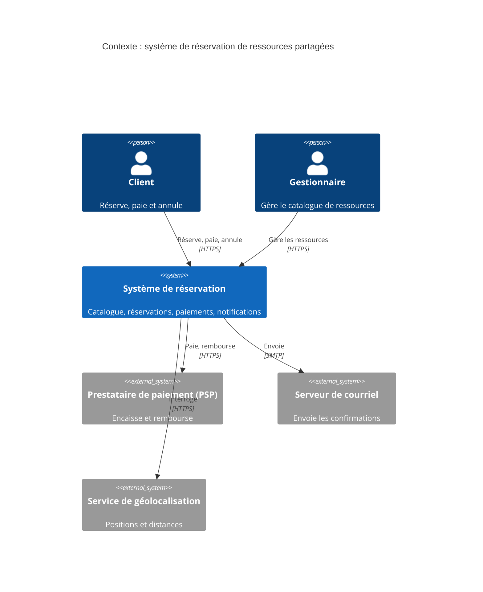

# ADR-001 : Attributs qualité prioritaires mesurables

- **Statut** : Proposé
- **Date** :
- **Variante** :
- **Séance** : S1

## Contexte

Les trois attributs qualité prioritaires de la variante, rendus mesurables par un scénario chacun. Pour chacun, indiquez la caractéristique ISO 25010 à laquelle il se rattache.

### Attribut 1 :

Caractéristique ISO 25010 :

| Partie | Scénario |
|--------|----------|
| Source | |
| Stimulus | |
| Environnement | |
| Artefact | |
| Réponse | |
| Mesure | |

### Attribut 2 :

Caractéristique ISO 25010 :

| Partie | Scénario |
|--------|----------|
| Source | |
| Stimulus | |
| Environnement | |
| Artefact | |
| Réponse | |
| Mesure | |

### Attribut 3 :

Caractéristique ISO 25010 :

| Partie | Scénario |
|--------|----------|
| Source | |
| Stimulus | |
| Environnement | |
| Artefact | |
| Réponse | |
| Mesure | |

## Options envisagées

Deux ordres de priorité possibles entre les trois attributs :

1. ... > ... > ... : ce que cet ordre protège en premier :
2. ... > ... > ... : ce que cet ordre protège en premier :

## Décision

Nous retenons l'ordre ... > ... > ... parce que ... (en vous appuyant sur les mesures des scénarios).

## Conséquences

- (+)
- (-) ce que l'attribut classé 3e risque de subir :

## Figure

C4 niveau 1, à adapter à la variante (acteurs, systèmes externes, libellés des flèches) :

