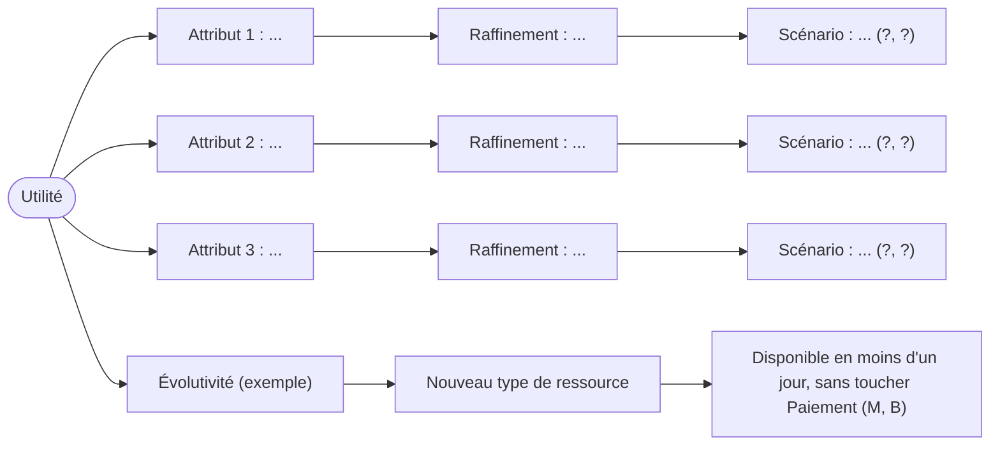

# ADR-002 : Compromis assumé

- **Statut** : Proposé
- **Date** :
- **Variante** :
- **Séance** : S2

## Contexte

- Ordre de priorité retenu dans ADR-001 :
- Deux attributs qui tirent en sens opposé dans la variante, et pourquoi (une phrase) :

## Options envisagées

Attributs candidats au sacrifice (parmi vos trois, ou un autre : coût, simplicité, cohérence immédiate, performance...) :

1. ... : ce que l'on perdrait :
2. ... : ce que l'on perdrait :

## Décision

Nous acceptons de dégrader ... parce que ...

Tactique retenue pour chaque attribut prioritaire (catalogue du cours de S2) :

| Attribut prioritaire | Tactique | Ce qu'elle coûte |
|----------------------|----------|------------------|
| 1. | | |
| 2. | | |
| 3. | | |

## Conséquences

- (+)
- (-)
- Point de compromis repéré (une décision qui touche deux attributs en sens opposés) :

## Figure

Utility tree, à compléter : un scénario d'ADR-001 par feuille (en quelques mots), noté (importance métier, difficulté technique) avec H (haute), M (moyenne) ou B (basse). La branche « Évolutivité » est l'exemple du starter, à garder ou à retirer.

