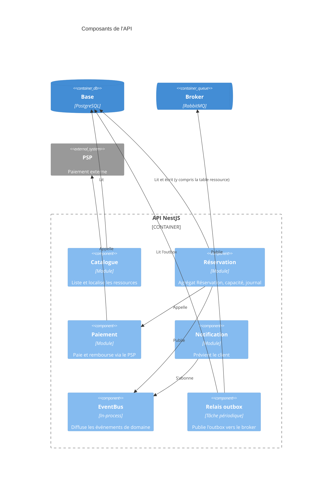

# ADR-003 : Découpage en modules

- **Statut** : Proposé
- **Date** :
- **Variante** :
- **Séance** : S3

## Contexte

- Attribut qualité d'ADR-001 qui pèse sur le découpage :
- Ce que le découpage actuel (Catalogue, Réservation, Paiement, Notification) gère mal pour la variante :
- Dépendance actuelle ou future qui menacerait cet attribut :

## Options envisagées

1. Garder les 4 modules actuels :
2. ... (module ajouté, scindé ou fusionné) :

## Décision

Nous retenons ... parce que ...

Dépendance interdite : `src/...` ne dépend jamais de `src/...`, parce que ...

Règle correspondante dans `.dependency-cruiser.cjs` : `nom-de-la-regle`

## Conséquences

- (+)
- (-)
- Violation volontaire détectée (ligne d'erreur de `npm run depcruise`) :

## Figure

C4 niveau 3 du conteneur API, à adapter (module ajouté, scindé ou fusionné ; dépendance interdite en rouge avec `UpdateRelStyle`) :

