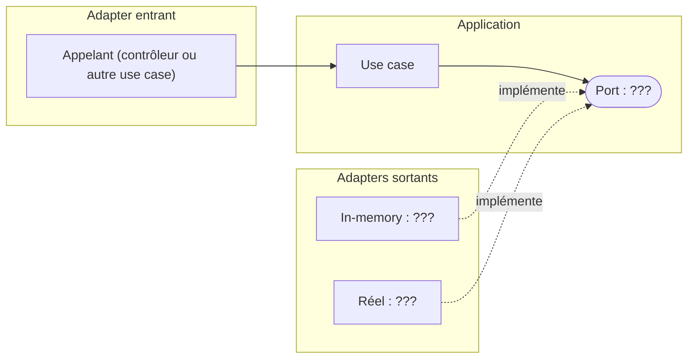

# ADR-004 : Pourquoi isoler cette dépendance derrière un port ?

- **Statut** : Proposé
- **Date** :
- **Variante** :
- **Séance** : S4 (format allégé : une alternative, une conséquence)

## Contexte

(Deux phrases.) Le use case `...` dépend directement de `...` (infra). Pour ma variante, cela menace l'attribut qualité `...` parce que ...

## Options envisagées

1. Isoler `...` derrière le port `...` (interface dans `ports/`, adapter réel et adapter in-memory).
2. Alternative écartée :

## Décision

Nous isolons `...` derrière le port `...`, nommé dans le langage du domaine (le nom peut différer de celui du token), parce que ...

## Conséquences

- ... (une seule, positive ou négative)

## Figure

Remplacer les trois `???` : le nom du port, de l'adapter in-memory et de l'adapter réel.

