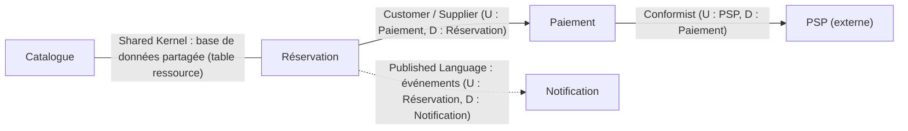

# ADR-005 : Frontière de l'agrégat central

- **Statut** : Proposé
- **Date** :
- **Variante** :
- **Séance** : S5

## Contexte

Règles métier de la variante qui ne doivent jamais être violées (préparées pour S5) :

| # | Règle | Porte sur un seul objet, ou sur plusieurs ? |
|---|-------|---------------------------------------------|
| 1 | | |
| 2 | | |
| 3 | | |
| 4 | | |
| 5 | | |

Agrégat actuel du starter : `Reservation` (racine), value object `Creneau` ; la capacité est lue **hors** de l'agrégat.

## Options envisagées

1. Garder `Reservation` comme agrégat central :
2. Autre racine (ou autre frontière) :

## Décision

- **Racine** :
- **Invariants protégés par l'agrégat** (numéros du tableau) :
- **Value objects** :
- **Hors de l'agrégat** (référencé par identifiant) :
- **Invariant non protégé par l'agrégat, et comment il l'est quand même** (contrainte en base, cohérence à terme, ...) :

## Conséquences

- (+)
- (-)

## Figure

Context map, avec **une** relation modifiée pour la variante (et sa justification en une ligne sous le diagramme) :

- Relation modifiée (entre quels contextes) :
- Nouveau type (partnership, shared kernel, customer/supplier, conformist, ACL : anticorruption layer, open host, published language) :
- Justification (une ligne, en citant un attribut qualité) :
