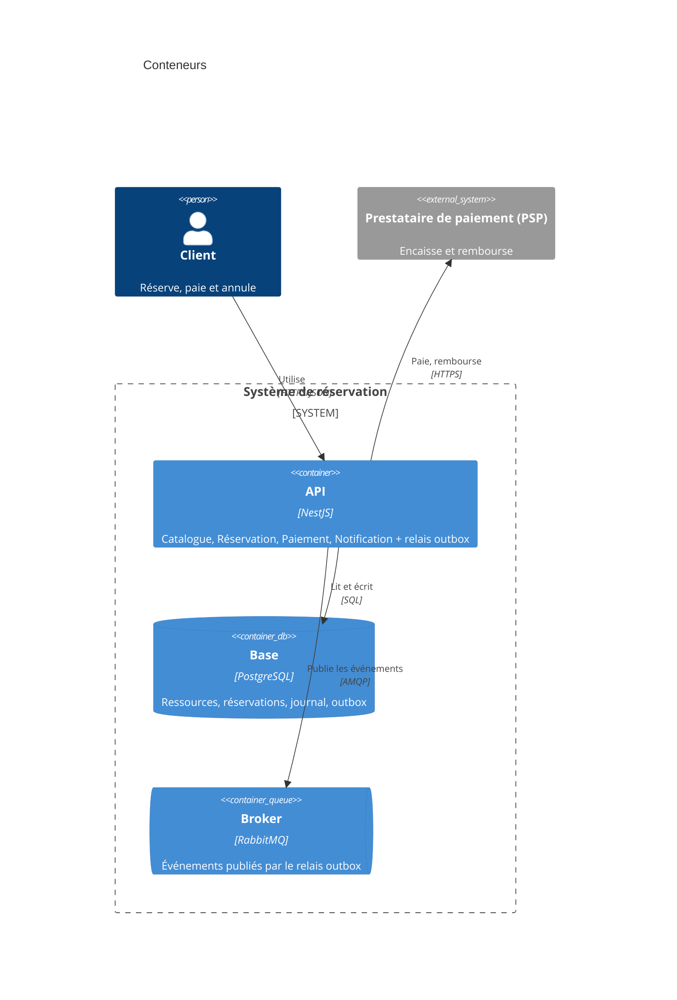

# ADR-007 : Extraire ou non le contexte ... ?

- **Statut** : Proposé
- **Date** :
- **Variante** :
- **Séance** : S7

## Contexte

- Contexte candidat à l'extraction, et critère qui le désigne (charge différente, isolation des pannes, rythme de livraison, contrainte externe) :
- Attribut qualité d'ADR-001 le plus touché par la décision :
- Architecture en vigueur après ADR-006 (ce qui a changé) :

Appels vers le contexte candidat (préparés pour S7) :

| Appelant | Ce qu'il demande | A-t-il besoin du résultat pour continuer ? |
|----------|------------------|-------------------------------|
| | | |
| | | |

## Options envisagées

1. Ne pas extraire : garder le monolithe modulaire, en préparant la ligne de coupe.
2. Extraire le contexte `...` en service, communication **synchrone** (HTTP).
3. Extraire le contexte `...` en service, communication **asynchrone** (messages via RabbitMQ).

## Décision

Nous retenons l'option ... parce que ...

## Conséquences

- (+)
- (-)
- Ce qui se passe si l'autre côté est indisponible :

## Figure

C4 niveau 2, à adapter : nouveau conteneur (et broker) si extraction ; sinon, mettez les conteneurs en cohérence avec vos ADR en vigueur, et annotez la ligne de coupe future dans le conteneur API :

