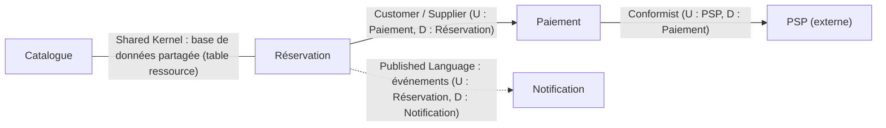

# Context map (gabarit générique)

Relations **constatées dans le starter**, pas forcément souhaitables. U = amont (upstream), D = aval (downstream).

Relations possibles : Partnership, Shared Kernel, Customer / Supplier, Conformist, Anticorruption Layer (ACL), Open Host Service, Published Language.
